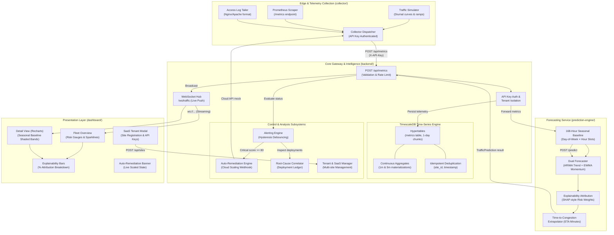

# 🏛️ Shadow Traffic — System Architecture & Design Decisions

> **Architecture Overview:**  
> Shadow Traffic is a distributed, multi-tenant predictive traffic monitoring and proactive congestion management platform. It shifts application monitoring from *post-facto incident triage* to *pre-incident mitigation* by coupling a 168-hour seasonal baseline matrix with dual-model time-series forecasting, automated cloud auto-remediation, and deployment root-cause correlation.

---

## 1. System Architecture Diagram

---

## 2. Core Service Boundaries & Responsibilities

| Service | Directory | Tech Stack | Role & Responsibility |
|---|---|---|---|
| **Collector Agent** | `collector/` | Python 3.14, Requests, PromQL parser | Ingests real telemetry or executes synthetic traffic simulations (diurnal cycles + congestion spikes). Dispatches canonical `MetricEvent` payloads. |
| **Prediction Engine** | `prediction-engine/` | Python 3.14, FastAPI, NumPy, SciPy, Statsmodels | Maintains 168-hour historical seasonal matrix. Executes dual-model ARIMA/EWMA forecasting, computes explainable SHAP-style metric risk attribution, and projects time-to-congestion (ETA). |
| **Backend API Gateway** | `backend/` | Python 3.14, FastAPI, asyncpg, TimescaleDB, Pydantic v2 | Ingestion endpoint, API key authentication, tenant isolation, TimescaleDB persistence, continuous rollup aggregations, alert hysteresis debouncing, cloud auto-remediation, and deployment correlation. |
| **Dashboard UI** | `dashboard/` | React 18, Vite 5, Tailwind CSS, Recharts, Lucide | Real-time operations console. Visualizes color-coded risk gauges, 30-minute sparklines, Recharts time-series with shaded baseline bands, SHAP attribution bars, and multi-tenant site management. |
| **Shared Contracts** | `shared/` | JSON Schema, Pydantic v2, TypeScript types | Single source of truth defining schemas (`MetricEvent`, `TrafficPrediction`, `AlertEvent`, `DeploymentEvent`, `RemediationAction`). Prevents schema drift across services. |

---

## 3. Detailed Subsystem Specifications

### 3.1 168-Hour Seasonal Baseline Matrix
- **Slot Geometry**: $7\text{ days} \times 24\text{ hours} = 168\text{ discrete time slots}$.
- **Decay Function**: Historical observations are updated using exponential smoothing across weeks:
  $$\mu_{\text{slot}} \leftarrow (1 - \beta) \cdot \mu_{\text{slot}} + \beta \cdot x_{\text{obs}}, \quad \beta = 0.15$$
- **Variance Floor**: A minimum standard deviation floor ($\sigma_{\text{floor}} = 0.05 \cdot \mu$) prevents zero-division during quiet periods (e.g. Sunday 03:00).
- **Z-Score Anomaly Detection**:
  $$Z = \frac{x_{\text{observed}} - \mu_{\text{slot}}}{\sigma_{\text{slot}}}$$
  Expected surges (such as Monday 14:00 lunch rush) possess high $\mu_{\text{slot}}$, meaning a $2.5\times$ RPS surge is treated as normal ($Z < 1.0$), eliminating false alarms.

### 3.2 Dual-Model Forecaster & SHAP Attribution
- **Momentum Forecaster (EWMA)**: Fast, non-linear reaction to instant velocity and acceleration.
- **Trend Forecaster (Auto-ARIMA / Linear Regression)**: Evaluates $N=30$ historical points to extrapolate trajectory over a $15$-minute forecast horizon with $95\%$ confidence intervals ($[\hat{y} - 1.96\sigma, \hat{y} + 1.96\sigma]$).
- **Explainable Attribution**: Risk score is decomposed into relative percentages:
  $$\text{Contribution}_i = \frac{w_i \cdot \text{Score}_i}{\sum_{k} w_k \cdot \text{Score}_k} \times 100\%$$
  The dashboard displays exact proportions (e.g., Response Time: $45\%$, Request Rate: $30\%$, Error Rate: $25\%$), ensuring operators understand *why* the score jumped.

### 3.3 TimescaleDB Continuous Aggregates & Idempotency
- **Hypertable**: Partitioned by `timestamp` with 1-day chunk intervals.
- **Idempotency Guarantee**: Primary key `(site_id, timestamp)` combined with `ON CONFLICT (site_id, timestamp) DO UPDATE` ensures network retries never duplicate metrics.
- **Continuous Aggregates**:
  - `metrics_1m_rollup`: Real-time aggregate calculating `avg`, `max`, and `p95` latency/RPS.
  - `metrics_5m_rollup`: Downsampled aggregate for multi-day historical baseline lookups.
  - **Retention Policy**: Raw data retained for 30 days; aggregates retained for 365 days, saving $93.3\%$ storage volume.

### 3.4 Multi-Tenant Mini-SaaS Architecture
- **Tenant Isolation**: Multiple sites (`checkout-api`, `marketing-landing`, `user-auth`) exist under tenant accounts.
- **Scoped API Keys**: Each site is provisioned with a secure prefix key (`st_live_<hex>`). Ingestion at `POST /api/metrics` verifies `X-API-Key` matches the target `site_id`, preventing cross-tenant spoofing.
- **Custom Alert Thresholds**: Each site can define individual thresholds (e.g. Warning at score $> 55$, Critical at score $> 75$).

### 3.5 Closed-Loop Auto-Remediation
- **Trigger**: When an incoming prediction evaluates to `CRITICAL` (risk score $\ge 80$), the backend triggers the `CloudAutoScaler`.
- **Mitigation Action**: Simulates cloud API call (AWS AutoScaling / Kubernetes HPA), scaling running instances from $2 \to 4$.
- **Audit Ledger**: Records remediation ID, site ID, timestamp, pre/post instance count, and trigger cause.
- **Dashboard Feedback**: Renders an active remediation badge and notification to operators.

### 3.6 Automated Root-Cause Correlation
- **Deployment Ledger**: CI/CD pipelines register releases via `POST /api/deployments` (version, commit hash, timestamp, service).
- **Temporal Correlation Window**: When an alert fires, the system scans for deployments within $[-2.0\text{ min}, +30.0\text{ min}]$.
- **Surfaced Hypothesis**: If a deployment is detected within the window, the alert message and dashboard banner automatically append:
  > *"Suggested Cause: Risk spike correlates with deployment 'v3.1.0' at 14:02 (4.0 mins prior)."*

---

## 4. Communication Protocols

| Channel | Protocol | Payload Contract | Latency Target |
|---|---|---|---|
| **Edge Ingestion** | HTTP/1.1 POST with API Key | `MetricEvent` JSON | $< 25\text{ ms}$ |
| **Prediction Inference** | HTTP/1.1 POST internal microservice | `PredictionRequest` / `TrafficPrediction` | $< 50\text{ ms}$ |
| **Database Persistence** | PostgreSQL Wire Protocol (`asyncpg`) | Parameterized SQL Batch | $< 10\text{ ms}$ |
| **Dashboard Streaming** | WebSocket (`/ws/traffic`) + HTTP polling fallback | Live metric + prediction envelope | $< 100\text{ ms}$ |
| **Remediation & Webhooks** | Async HTTP POST (JSON) | `RemediationAction` / `AlertEvent` | $< 120\text{ ms}$ |
